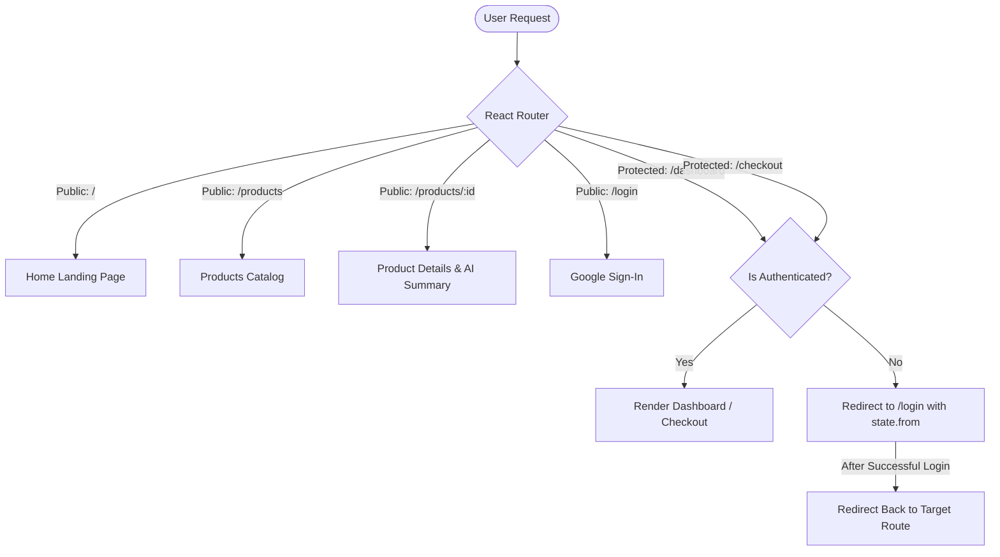

# 🛒 Smart AI Shop (SmartShop)

[](https://react.dev/)
[](https://www.typescriptlang.org/)
[](https://vitejs.dev/)
[](https://tailwindcss.com/)
[](https://firebase.google.com/)
[](https://axios-http.com/)

A modern, high-performance, and minimal e-commerce web application. Built with **React 19**, **Vite**, **TypeScript**, **Tailwind CSS v4**, and **Firebase Authentication**. Features include a live product catalog powered by Fake Store API, AI-assisted review summaries, user dashboard, frictionless checkout, and protected routes.

---

## 📑 Table of Contents

1. [🎯 Why This Project Was Built (Purpose)](#-why-this-project-was-built-purpose)
2. [✨ Key Features](#-key-features)
3. [🛠️ Tech Stack & Why It Was Chosen](#️-tech-stack--why-it-was-chosen)
4. [📂 Project Structure](#-project-structure)
5. [🔌 API Endpoints Documentation](#-api-endpoints-documentation)
6. [🔐 Environment Variables (.env.example)](#-environment-variables-envexample)
7. [💻 How to Run Locally (Step-by-Step)](#-how-to-run-locally-step-by-step)
8. [🛡️ Routing & Authentication Architecture](#️-routing--authentication-architecture)
9. [📜 Available Scripts](#-available-scripts)
10. [🔮 Future Roadmap](#-future-roadmap)

---

## 🎯 Why This Project Was Built (Purpose)

Traditional e-commerce templates are often bloated with heavy dependencies, slow rendering pipelines, and complex setup requirements. **Smart AI Shop** was engineered with the following core goals:

1. **Lightweight & High-Performance Shopping Experience**: Utilize React 19 and Vite to provide instant page loads, sub-second HMR during development, and minimal bundle size.
2. **AI-Enhanced Product Insights**: Overcome review fatigue. The product details view includes an intelligent review synthesis widget (`AI Summary`) that aggregates customer sentiment and key highlights, helping shoppers make faster buying decisions.
3. **Seamless & Secure Customer Authentication**: Remove friction by implementing passwordless, one-click Google Sign-In with Firebase Authentication, ensuring secure session management without complex custom auth servers.
4. **Architectural Best Practices**: Demonstrate a clean, modular, and scalable Single Page Application (SPA) architecture featuring protected routes, context-driven auth state, error boundary handling, and skeleton loaders.
5. **Modern Minimalist UI/UX**: Deliver a crisp aesthetic with micro-interactions, responsive grids, and clean typography built on Tailwind CSS v4.

---

## ✨ Key Features

- **⚡ Blazing Fast Dynamic Catalog**: Real-time product fetching using Axios and the Fake Store REST API.
- **🤖 AI Product Synthesis**: Dynamic AI summary card highlighting aggregate customer ratings and sentiment for each product.
- **🔒 Secure Authentication**: Instant Google OAuth 2.0 login powered by Firebase Authentication with automatic session persistence.
- **🛡️ Protected Routes**: Guarded user routes (`/dashboard` and `/checkout`) that automatically preserve the attempted location and redirect unauthenticated visitors to login.
- **👤 Interactive User Dashboard**: Personalized user profile display with active order statistics, wishlist counter, and simulated order history.
- **🛍️ Streamlined Checkout**: Comprehensive checkout workflow with order summary calculations, shipping information form, and cash-on-delivery selection.
- **📱 Fully Responsive Design**: Mobile-first design adaptable from small smartphones to ultrawide desktop monitors.
- **💫 Modern Loading States**: Skeleton placeholders and spinners preventing layout shifts during asynchronous network fetches.

---

## 🛠️ Tech Stack & Why It Was Chosen

| Technology | Purpose | Why It Was Chosen? |
| :--- | :--- | :--- |
| **React 19** | Frontend UI Framework | Industry standard component-based UI library. Offers concurrent rendering, fast reconciliation, and seamless state management. |
| **Vite 8** | Build Tool & Dev Server | Offers instantaneous development server startup and lightning-fast Hot Module Replacement (HMR) powered by esbuild and Rollup. |
| **TypeScript (~6.0)** | Programming Language | Adds static type definitions to JavaScript, eliminating runtime errors, auto-completing API response types, and improving maintainability. |
| **Tailwind CSS v4** | CSS Framework | Modern utility-first CSS engine. Extremely fast compilation using `@tailwindcss/vite`, zero runtime CSS bloat, and consistent design tokens. |
| **React Router v7** | Client-Side Routing | Provides declarative SPA routing, nested routes, dynamic URL parameters (`/products/:id`), and route protection (`ProtectedRoute`). |
| **Firebase v12** | Authentication & Cloud | Battle-tested Google OAuth provider. Eliminates the need to build and maintain a custom auth server while ensuring token security. |
| **Axios** | HTTP Client | Promise-based HTTP client offering automatic JSON transformation, timeout control, and cleaner error handling compared to native `fetch`. |
| **Fake Store API** | External Mock Backend | Free, reliable RESTful API supplying real-world e-commerce datasets (products, descriptions, prices, categories, and ratings). |
| **Oxlint** | Linter | Ultra-fast modern linter for TypeScript and React ensuring clean, idiomatic code standards. |

---

## 📂 Project Structure

```text
smart_ai_shop/
└── smart_shop/
    ├── public/                     # Static public assets
    ├── src/
    │   ├── assets/                 # Images, SVGs, and brand assets
    │   ├── components/
    │   │   ├── home/               # Landing page modular sections
    │   │   │   ├── Categories.tsx      # Product category shortcuts
    │   │   │   ├── FeaturedProducts.tsx# Curated product list (limit=8)
    │   │   │   ├── Hero.tsx            # Hero banner & call-to-actions
    │   │   │   ├── Newsletter.tsx      # Email subscription section
    │   │   │   ├── Testimonials.tsx    # Customer reviews & ratings
    │   │   │   └── WhyChooseUs.tsx     # Value propositions & guarantees
    │   │   ├── layout/             # Global layout components
    │   │   │   ├── Navbar.tsx          # Dynamic top navigation & auth status
    │   │   │   └── Footer.tsx          # Site footer & external links
    │   │   └── shared/             # Reusable UI widgets
    │   │       └── ProductCard.tsx     # Product card with image, price & rating
    │   ├── context/
    │   │   └── AuthContext.tsx     # React Context for Firebase user state
    │   ├── pages/                  # Page-level route views
    │   │   ├── Home.tsx            # Main landing page
    │   │   ├── Login.tsx           # Google Sign-In view
    │   │   ├── Products.tsx        # Full product catalog grid
    │   │   ├── ProductDetails.tsx  # Single product details + AI summary
    │   │   ├── Dashboard.tsx       # User profile, statistics & orders
    │   │   └── Checkout.tsx        # Shipping form & order placement
    │   ├── routes/
    │   │   └── ProtectedRoute.tsx  # Authentication route guard
    │   ├── services/
    │   │   └── firebase.ts         # Firebase App & Auth initialization
    │   ├── App.tsx                 # Root application routes & providers
    │   ├── main.tsx                # React DOM render entry point
    │   └── index.css               # Tailwind CSS imports & global styles
    ├── .env                        # Local environment variables (Git ignored)
    ├── .env.example                # Template for environment variables
    ├── .gitignore                  # Git exclusion list
    ├── package.json                # Project dependencies and scripts
    ├── tsconfig.json               # TypeScript configuration
    └── vite.config.ts              # Vite + Tailwind + React configuration
```

---

## 🔌 API Endpoints Documentation

The application communicates with the **Fake Store API** via the base URL configured in your `.env` file (`VITE_API_FOR_THIS_PROJECT`).

**Base URL**: `https://fakestoreapi.com/products`

### Endpoints Used in Application

| Endpoint | Method | Component / Page | Description | Query / Params |
| :--- | :---: | :--- | :--- | :--- |
| `/products` | `GET` | `Products.tsx` | Fetches the full list of available products. | None |
| `/products?limit={n}` | `GET` | `FeaturedProducts.tsx` | Retrieves a specified number of featured items. | `limit=8` |
| `/products/{id}` | `GET` | `ProductDetails.tsx` | Fetches complete details for a single product by its numeric ID. | `id` (e.g. `1`) |
| `/products/categories` | `GET` | `Categories.tsx` | *(Optional reference)* Retrieves all product category strings. | None |
| `/products/category/{cat}` | `GET` | Category Filtering | *(Optional reference)* Filters products belonging to a specific category. | `cat` (e.g. `electronics`) |

### Sample Response Payload (`GET /products/1`)

```json
{
  "id": 1,
  "title": "Fjallraven - Foldsack No. 1 Backpack, Fits 15 Laptops",
  "price": 109.95,
  "description": "Your perfect pack for everyday use and walks in the forest. Stash your laptop (up to 15 inches) in the padded sleeve...",
  "category": "men's clothing",
  "image": "https://fakestoreapi.com/img/81fPKd-2AYL._AC_SL1500_.jpg",
  "rating": {
    "rate": 3.9,
    "count": 120
  }
}
```

---

## 🔐 Environment Variables (.env.example)

The application requires specific environment variables to connect to Firebase Authentication and the product API.

### `.env.example` File

```env
# Firebase Authentication Configuration
VITE_FIREBASE_API_KEY="your_firebase_api_key_here"
VITE_FIREBASE_AUTH_DOMAIN="your_firebase_auth_domain_here"
VITE_FIREBASE_PROJECT_ID="your_firebase_project_id_here"
VITE_FIREBASE_STORAGE_BUCKET="your_firebase_storage_bucket_here"
VITE_FIREBASE_MESSAGING_SENDER_ID="your_firebase_messaging_sender_id_here"
VITE_FIREBASE_APP_ID="your_firebase_app_id_here"

# Product API Endpoint
VITE_API_FOR_THIS_PROJECT="https://fakestoreapi.com/products"
```

### How to Get Firebase Credentials

1. Go to the [Firebase Console](https://console.firebase.google.com/).
2. Click **Create a project** (or select an existing one).
3. Under **Build**, select **Authentication** and click **Get Started**.
4. In the **Sign-in method** tab, enable the **Google** provider.
5. In **Project Settings** (gear icon in the sidebar) > **General**, scroll down to **Your apps**.
6. Click the Web icon (`</>`) to register a web app.
7. Copy the configuration object values and paste them into your `.env` file.

> [!IMPORTANT]
> Never commit your production `.env` file to public version control. Ensure `.env` is listed in `.gitignore`.

---

## 💻 How to Run Locally (Step-by-Step)

Follow these instructions to run the application on your local development machine:

### 1. Prerequisites

Ensure you have the following installed on your machine:
- **Node.js**: v18.0.0 or higher (v20+ recommended)
- **npm** (comes with Node.js) or **pnpm** / **yarn**
- **Git**

Verify your Node version:
```bash
node -v
npm -v
```

### 2. Clone the Repository

```bash
git clone https://github.com/your-username/smart_ai_shop.git
cd smart_ai_shop/smart_shop
```
*(If you are already inside the workspace directory, simply make sure your terminal is inside `smart_shop`)*:
```bash
cd smart_shop
```

### 3. Install Dependencies

```bash
npm install
```

### 4. Configure Environment Variables

Create your local `.env` file from the provided template:

**On Windows (PowerShell):**
```powershell
Copy-Item .env.example .env
```

**On Linux / macOS / Git Bash:**
```bash
cp .env.example .env
```

Open `.env` and fill in your Firebase configuration keys.

### 5. Start the Local Development Server

```bash
npm run dev
```

The application will start locally at:
```text
http://localhost:5173
```
Open the URL in your browser to view the application.

---

## 🛡️ Routing & Authentication Architecture

The application uses **React Router v7** combined with a custom `ProtectedRoute` component:



### Route Breakdown

| Path | Access | Guarded By | Description |
| :--- | :--- | :--- | :--- |
| `/` | Public | None | Hero, Category showcase, Featured products, Reviews, Newsletter. |
| `/products` | Public | None | Complete grid of all available products with skeleton loading. |
| `/products/:id` | Public | None | Detailed view with image, rating, full description, and AI summary. |
| `/login` | Public | None | Firebase Google Auth login page. |
| `/dashboard` | **Protected** | `<ProtectedRoute />` | Authenticated user stats, profile card, and past orders. |
| `/checkout` | **Protected** | `<ProtectedRoute />` | Address form, payment option, and order confirmation. |

---

## 📜 Available Scripts

Inside the `smart_shop` directory, you can run:

- `npm run dev`: Starts the Vite development server with Hot Module Replacement.
- `npm run build`: Compiles TypeScript (`tsc -b`) and bundles production assets using Vite.
- `npm run preview`: Locally previews the production build output from the `dist/` directory.
- `npm run lint`: Analyzes the codebase using Oxlint for fast syntax and linting checks.

---

## 🔮 Future Roadmap

- [ ] Connect custom Gemini API / OpenAI API to provide dynamic, LLM-generated product recommendation summaries.
- [ ] Implement global persistent Cart & Wishlist state with Redux Toolkit or Zustand.
- [ ] Integrate Stripe / SSLCommerz payment gateway integration.
- [ ] Cloud Firestore integration for real-time order storage and user address management.

---

## 📄 License

This project is licensed under the [MIT License](LICENSE). Feel free to use and customize for educational or commercial purposes.
